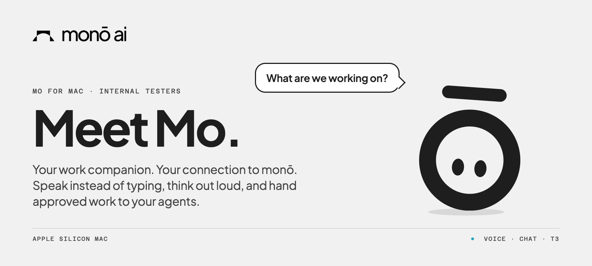
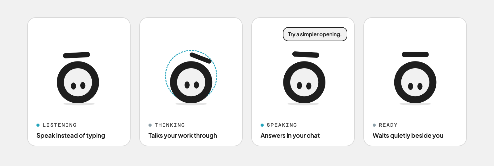

  

  

<h2 align="center"><a href="https://github.com/YML87/mo-releases/releases/latest">⬇ Download the latest Mo for Mac</a></h2>

  On the release page, choose the file ending in <b>.dmg</b>. 
  APPLE SILICON (M1 OR LATER) · FOR MONŌ INTERNAL TESTERS · INSTALLERS ONLY, NO SOURCE CODE

---

## What Mo is

Mo is an AI work companion for your Mac. It brings **voice dictation** and **conversation with monō** into one app, so you can speak instead of type, think your work through, and send approved requests to agents through **T3**.

- **Mo** is the companion you talk to.
- **monō** is the AI platform behind the conversation.
- **T3** runs the connected agent work and keeps its conversations.

  

## Install in four steps

| Step | What to do |
|---|---|
| **1. Download** | Open the [latest release](https://github.com/YML87/mo-releases/releases/latest) and download **mo-VERSION-arm64.dmg**. |
| **2. Drag** | Open the file and drag **Mo** onto the **Applications** folder. |
| **3. Open** | Open Mo from Applications. This build isn't Apple-notarised yet, so the first time macOS may stop it. Go to **System Settings → Privacy & Security** and choose **Open Anyway**. |
| **4. Allow** | When asked, allow the **Microphone**, and **Accessibility** so Mo can paste your dictated text. |

> **After each update** you may need to allow Microphone and Accessibility again. That stops once Mo is signed with an Apple Developer ID.

## What works today

| Feature | What it does |
|---|---|
| 🎙️ **Voice dictation** | Speak and your words appear as text in the app you're using. |
| 💬 **Chat with monō** | Ask questions, develop ideas and think your work through. Dictation and chat are separate today, not one spoken conversation. |
| 🧠 **Saved context** | Chats, summaries and your confirmed decisions are saved to Mo Brain. Choose **Don't save this chat** to turn that off. |
| 📁 **Project context** | The chat header shows the current project, open jobs and latest checkpoint from Mo Brain. These are saved records, not a live check. |
| 🔗 **Work through T3** | Authorise Mo in your browser, pick a project and conversation, and review every message or agent request before it's sent. |
| ⬆️ **Update check** | **Settings → System → Check for updates** looks only here, only when you click, and checks the download before opening it. You install it by hand. |

<b>How the T3 connection works</b>

 

Mo remembers approved T3 access and connects automatically while both apps are running. Expired or revoked access needs authorising again. Connection problems may need attention; permanent availability is not promised.

Normal Mo chat never starts agents or sends work on its own. Agent requests go to an existing monō conversation in T3 for coordination, and a queued request is not proof an agent has started.

Mo records its integration requests, receipts and failures, and shows the activity T3 reports, not every action on your computer. T3 keeps its own conversations even when **Don't save** is on.

## Coming soon

| Feature | Status |
|---|---|
| **Chat-to-work handoff.** Ask, prepare a request, approve it once and track the result | Built and tested, not live yet |
| **Start new work from Mo.** New T3 conversation or project, or open Terminal in a project folder | Built and tested, not live yet |
| **Calendar connections.** Google Calendar and Microsoft calendars | Waiting on monō sign-in keys |
| **Automatic project discovery.** Find and open the right project when the match is clear | Proposed |
| **Company data access.** Find permitted information through monō's company connections | Needs wiring and testing |
| **Screen awareness.** Help in context, with your permission | Not yet a working capability |
| **Spoken conversation and computer actions.** Talk with Mo and let it carry out approved tasks | Not yet a working capability |

<b>What are the other files on the release page?</b>

 

- **mo-VERSION-arm64.zip**: the same app in a zip, used by Mo's own update check.
- **latest-mac.yml** and **mo-release-receipt.json**: the sizes and fingerprints Mo uses to confirm a download is genuine.

You only need the **.dmg**.

---

MO · BY MONŌ AI · SYDNEY

